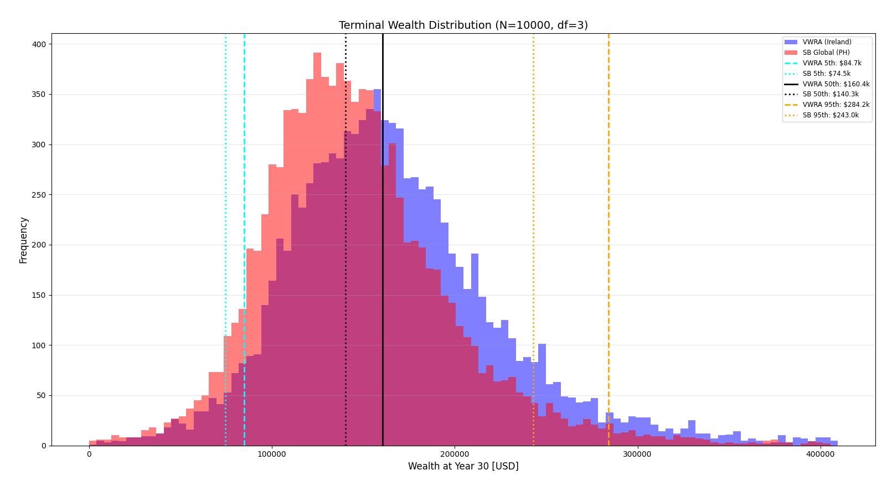
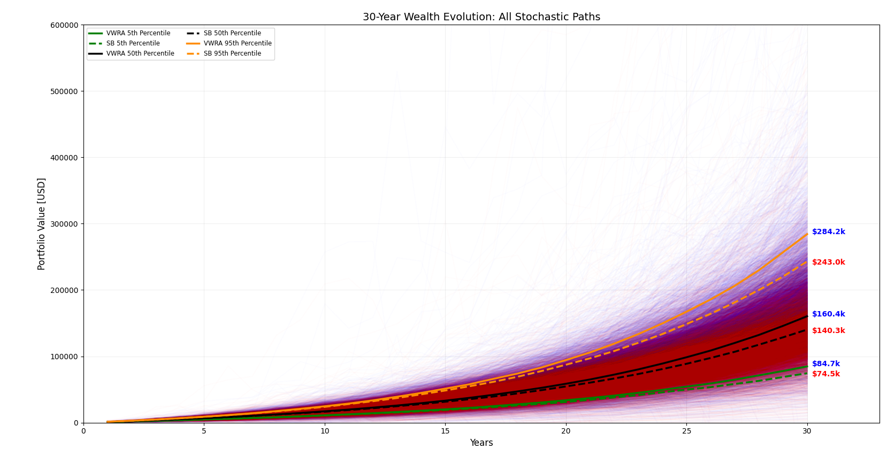
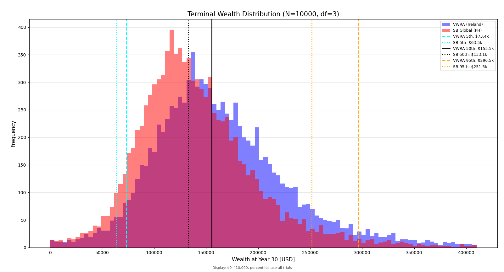
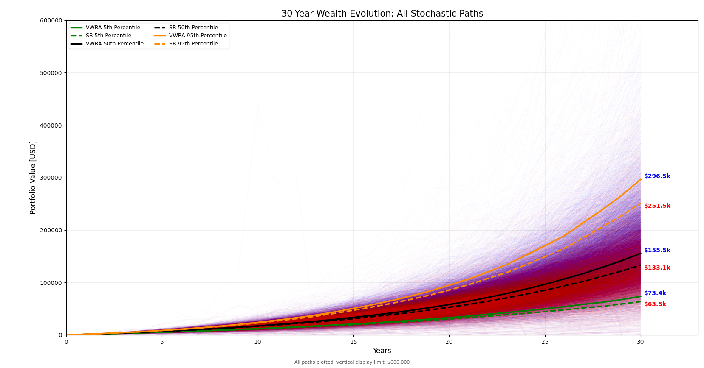

# IBKR vs. Local Feeder Funds

**Author: Christian Klein C. Ramos ([Lolfaceftw](https://github.com/Lolfaceftw))**

A Python Monte Carlo comparison of VWRA through IBKR and SB Global Equity Index Feeder Fund. The model follows 10,000 paired investment paths over 30 years, measuring how annual expenses, dividend withholding, and conversion charges affect portfolio wealth.

## Charts





Chart images from the [analysis on r/phinvest](https://www.reddit.com/r/phinvest/comments/1pr42yz/the_real_cost_of_an_sec_block_simulating_ibkr/).

## Run

Requires Python 3.11 or newer.

```sh
python -m pip install -r requirements.txt
python simulate.py --config config.json --output results
```

Edit [config.json](config.json) to change the contribution, market assumptions, or fund costs. Each run writes PNG/SVG charts, annual percentile tables, a JSON summary, and all portfolio paths.

## Model

| Setting | Value |
| --- | --- |
| Annual contribution | $1,025, invested at the start of each year |
| Initial portfolio | $0 |
| Horizon / trials | 30 years / 10,000 |
| Annual return location / volatility | 10% / 12% |
| Innovations | Unit-variance Student-t, 3 degrees of freedom |
| GARCH alpha / beta | 0.05 / 0.90 |
| Dividend yield | 2% per year |
| VWRA annual expense / dividend withholding | 0.19% / 15% |
| SB annual expense / dividend withholding | 0.755% / 25% |
| VWRA contribution conversion charge | Uniform 0.20%–0.35% |
| Random seed | 42 |

The two portfolios share market returns in every trial. Conversion charges apply to VWRA contributions. Dividend withholding applies to the assumed dividend yield; annual expenses apply to the resulting portfolio value. Rates are fixed scenario inputs, not a statement of current fees or tax treatment.

See [METHODS.md](METHODS.md) for equations and assumptions.

## Simulation outputs





- [Annual percentiles](results/percentiles.csv)
- [Summary and settings](results/summary.json)
- [Full portfolio paths](results/paths.npz), with arrays `vwra` and `sb`

Run `python verify.py` to check repeatability and saved data against the simulation.

## Files

| File | Purpose |
| --- | --- |
| [simulate.py](simulate.py) | Market returns, fund accounting, and exports |
| [charts.py](charts.py) | Histogram and portfolio-path plots |
| [config.json](config.json) | Numerical assumptions |
| [assets/originals/](assets/originals/) | Downloaded chart images |
| [results/](results/) | Outputs from the supplied configuration |

Code is available under the [MIT license](LICENSE). Chart images retain their existing rights.
